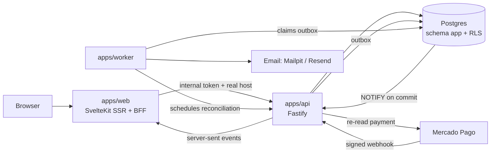

# Sortea

Multi-tenant platform for campaign commerce, prize operations and public transparency. Each organization gets its own domain, theme, Mercado Pago account and isolated data. **MotoGarage** (Arrecifes, Buenos Aires) is the first tenant.

> Paid participations stay disabled until a campaign has legal and payment-provider approvals on record. The platform never invents them: a campaign cannot open without them (see [Draw integrity](docs/spec/DRAW-INTEGRITY.md)).

## What is in the box

| Area | Status |
| --- | --- |
| Tenancy: hostname → organization, row level security per organization, roles | Done |
| Themes per organization (design tokens, dark/light, WCAG AA fallback) | Done |
| MotoGarage site: roller-shutter hero, scroll-driven piston cycle | Done |
| Campaign microsite: prizes, countdown on server time, rules, compliance state | Done |
| Transparency: versioned rules, public log, frozen manifest with SHA-256 | Done |
| Shop, cart with explicit extras, guest checkout with separate consents | Done |
| Mercado Pago Checkout Pro, signed webhooks, idempotent confirmation | Done (sandbox and local simulator) |
| Participation ledger (append-only), refunds void entries without deleting them | Done |
| Private lookup by document + emailed code, or receipt code | Done |
| Signed, expiring downloads for digital products | Done |
| Durable outbox and email (Mailpit locally, Resend in production) | Done |
| Admin: live dashboard (snapshot plus server-sent events, resync after disconnects), orders with masked data, campaigns, audit | Done |
| Platform console: organizations, write-only credentials, theme, domains | Done |
| Payment reconciliation: scheduled checks, settlement reports, human resolution, CSV exports | Done |
| Awards: results checked against the manifest, alternates, verification and per-unit delivery (AC-06) | Done |
| Product and prize editing, CMS editor | Next phase |

## Architecture



- `packages/domain`: pure business rules (pricing, campaign lifecycle and compliance gate, payment state, documents, manifest, themes) plus server crypto (sealed secrets, webhook signatures, tokens).
- `packages/db`: Drizzle schema, migrations, seed and the `withTenant` / `withPlatform` database handle.
- `apps/api`: the only place with business rules and secrets. Private except `/webhooks/*`.
- `apps/web`: SSR pages and a thin BFF. Browsers never call the API.
- `apps/worker`: outbox processing, email, order expiry, and the clock for payment reconciliation (the API does the work).

Key decisions are recorded in [docs/adr](docs/adr). The product brief lives in [docs/spec](docs/spec).

## Run it locally

Requirements: Node 22.17+, pnpm 11, Docker Desktop, Supabase CLI.

On Windows, `scripts/dev/run-all.bat` does everything below in one step: it checks the tooling, starts Docker Desktop and local Supabase, writes `.env` when missing, refreshes dependencies, migrates, seeds and starts the stack in its own window. `run-all.bat test` prepares the same way and runs the typecheck, the test suites and the E2E tests; `run-all.bat doctor` only reports what is missing (`pnpm doctor` does the same on any OS). Set `SEED_ADMIN_PASSWORD` in `.env` so the local accounts have a known password and the E2E tests can sign in.

```bash
pnpm install
pnpm db:start        # local Supabase (Postgres, Auth, Storage, Mailpit)
pnpm setup:env       # writes .env from `supabase status` with fresh secrets
pnpm db:migrate
pnpm db:seed         # prints the password of the local admin accounts
pnpm dev             # api :3001, worker, web :5173
```

| URL | What |
| --- | --- |
| http://localhost:5173 | MotoGarage |
| http://pista.localhost:5173 | Pista Sur, a fictional second tenant |
| http://localhost:5173/admin | Admin panel |
| http://127.0.0.1:54324 | Mailpit: every email sent locally |
| http://127.0.0.1:54323 | Supabase Studio |

Seeded accounts (password printed by the seed): `admin@sortea.local` (platform), `owner@motogarage.local`, `operador@motogarage.local`, `finanzas@motogarage.local`, `owner@pistasur.local`.

Payments run against a **local simulator** (`PAYMENTS_FAKE_PROVIDER=true`): checkout redirects to `/pago-simulado`, and approving there sends a signed notification through the real webhook path. To test real Mercado Pago sandbox credentials, set `PAYMENTS_FAKE_PROVIDER=false`, load the credentials in the platform console and expose the API with a tunnel so Mercado Pago can reach `API_PUBLIC_URL`.

`pnpm db:reset` drops and rebuilds the local database (local hosts only).

## Tests

```bash
pnpm check                 # TypeScript and Svelte checks
pnpm test                  # domain, db, api and worker against real Postgres
E2E_ADMIN_PASSWORD=... pnpm test:e2e   # Playwright against the running stack
```

The API suite covers the acceptance criteria of the PRD, among them: ten duplicate webhooks confirm once (AC-01), tenants cannot read or write each other (AC-02), browser returns never confirm (AC-03), secrets never leave the API (AC-05), multi-prize campaigns with independent awards, alternates and deliveries (AC-06), lookups resist enumeration (AC-07), reconciliation detects missing payments, different amounts, refunds and settlement discrepancies (AC-09), the dashboard resyncs after losing its connection (AC-04), rules cannot be rewritten silently (AC-08), the manifest hash is recomputable (AC-11) and campaigns cannot open without approvals (AC-12). Rate limits live in memory, so restart the API between repeated E2E runs.

## Deploy (Railway + Supabase)

Three Railway services from this repository, one Supabase project:

| Service | Build | Start | Notes |
| --- | --- | --- | --- |
| web | `pnpm install && pnpm --filter @sortea/web build` | `node apps/web/build` | Public. Set `HOST_HEADER=x-forwarded-host`, `PROTOCOL_HEADER=x-forwarded-proto`. |
| api | `pnpm install` | `pnpm --filter @sortea/api start` | Private network, plus a public route for `/webhooks/*` only. |
| worker | `pnpm install` | `pnpm --filter @sortea/worker start` | No public port. Needs `API_INTERNAL_URL` and `INTERNAL_API_TOKEN` to schedule reconciliation. |

Production requires `REQUIRE_ADMIN_MFA=true`, `PAYMENTS_FAKE_PROVIDER=false`, `EMAIL_PROVIDER=resend` and secrets generated per environment (`SECRETS_KEY_RING`, peppers, `INTERNAL_API_TOKEN`). The API's `DATABASE_URL` must be Supabase's direct connection or the session pooler (port 5432): the live dashboard uses `LISTEN`, which the transaction pooler does not support (ADR 0007). Run `pnpm db:migrate` against the Supabase connection string before each release. Each custom domain is added in the platform console and pointed to the web service.

## Brand assets

`apps/web/static/tenants/motogarage` holds the logo and the workshop photo provided by MotoGarage. Prize photos and videos are added per campaign; the campaign page shows a typographic placeholder until a real photo exists, by design.
