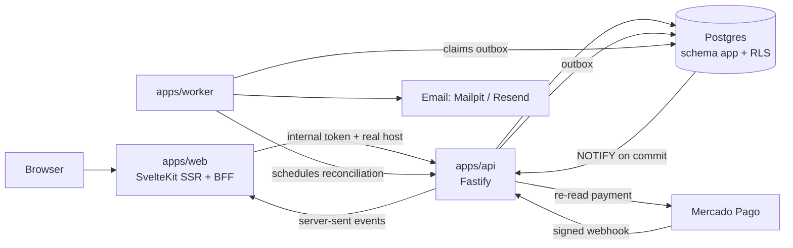

# Sortea

Multi-tenant platform for campaign commerce, prize operations and public transparency. Each organization gets its own domain, theme, brand site, Mercado Pago account and isolated data.

> Paid participations stay disabled until a campaign has legal and payment-provider approvals on record. The platform never invents them: a campaign cannot open without them (see [Draw integrity](docs/spec/DRAW-INTEGRITY.md)).

## What is in the box

| Area | Status |
| --- | --- |
| Tenancy: hostname → organization, row level security per organization, roles | Done |
| Themes per organization (design tokens, dark/light, WCAG AA fallback) | Done |
| Brand sites switched by CMS content (the first one: roller-shutter hero, scroll-driven piston cycle) | Done |
| Campaign microsite: prizes, countdown on server time, rules, compliance state | Done |
| Transparency: versioned rules, public log, frozen manifest with SHA-256 | Done |
| Shop, cart with explicit extras, guest checkout with separate consents | Done |
| Mercado Pago Checkout Pro (Orders API), signed order webhooks, idempotent confirmation | Done (sandbox and local simulator) |
| Participation ledger (append-only), refunds void entries without deleting them | Done |
| Private lookup by document + emailed code, or receipt code | Done |
| Signed, expiring downloads for digital products | Done |
| Durable outbox and email (Mailpit locally, Resend in production) | Done |
| Admin: live dashboard (snapshot plus server-sent events, resync after disconnects), orders with masked data, campaigns, audit | Done |
| Platform console: organizations, write-only credentials, theme, domains | Done |
| Payment reconciliation: scheduled checks, settlement reports, human resolution, CSV exports | Done |
| Awards: results checked against the manifest, alternates, verification and per-unit delivery (AC-06) | Done |
| Quiniela draw (ADR 0014): coupons 0000-9999, prizes matched against the 20 official extracts; a vacant prize reopens the campaign for a new round with its own closing date, manifest and draw | Done |
| Catalog and prize editing: drafts, variants with es-AR prices, archive instead of delete; prizes frozen once open | Done |
| Site editor (CMS): brand, home, SEO/OpenGraph, banner, restorations gallery with photo credits, legal texts with versions, FAQs, image library; drafts, publishing and history | Done |

## Architecture



- `packages/domain`: pure business rules (pricing, campaign lifecycle and compliance gate, payment state, documents, manifest, themes) plus server crypto (sealed secrets, webhook signatures, tokens).
- `packages/db`: Drizzle schema, migrations, seed, client packs and the `withTenant` / `withPlatform` database handle.
- `apps/api`: the only place with business rules and secrets. Private except `/webhooks/*`.
- `apps/web`: SSR pages and a thin BFF. Browsers never call the API.
- `apps/worker`: outbox processing, email, order expiry, and the clock for payment reconciliation (the API does the work).

Key decisions are recorded in [docs/adr](docs/adr). The product brief lives in [docs/spec](docs/spec).

## Run it locally

Requirements: Node 22.17+, pnpm 11, Docker Desktop, Supabase CLI.

On Windows, `scripts/dev/run-all.bat` does everything below in one step: it checks the tooling, starts Docker Desktop and local Supabase, writes `.env` when missing, refreshes dependencies, migrates, seeds and starts the stack in its own window. `run-all.bat test` prepares the same way and runs the typecheck, the test suites and the E2E tests; `run-all.bat doctor` only reports what is missing (`pnpm doctor` does the same on any OS). Set `SEED_ADMIN_PASSWORD` in `.env` so the local accounts have a known password and the E2E tests can sign in.

```bash
pnpm install
pnpm db:start        # local Supabase (Postgres, Auth, Storage, Mailpit)
pnpm setup:env       # writes .env from `supabase status` with fresh secrets
pnpm db:migrate
pnpm db:seed         # prints the password of the local admin accounts
pnpm db:geo          # countries, provinces and cities from GeoNames (downloads once)
pnpm dev             # api :3001, worker, web :5173
```

| URL | What |
| --- | --- |
| http://localhost:5173 | Taller Demo, the fictional first organization (http://demo.localhost:5173 when a client pack already has `localhost`) |
| http://pista.localhost:5173 | Pista Sur, a fictional second tenant |
| http://localhost:5173/admin | Admin panel |
| http://127.0.0.1:54324 | Mailpit: every email sent locally |
| http://127.0.0.1:54323 | Supabase Studio |

Seeded accounts (password printed by the seed): `admin@sortea.local` (platform), `owner@tallerdemo.local`, `operador@tallerdemo.local`, `finanzas@tallerdemo.local`, `owner@pistasur.local`.

The seed is additive: on a database that already has data it creates Taller Demo and Pista Sur only when they are missing and never changes another organization's rows. Taller Demo takes `localhost`, `127.0.0.1` and `demo.localhost`, skipping any host another organization already has; the seed prints the address it got.

Payments run against a **local simulator** (`PAYMENTS_FAKE_PROVIDER=true`): checkout redirects to `/pago-simulado`, and approving there sends a signed notification through the real webhook path. To test real Mercado Pago sandbox credentials, set `PAYMENTS_FAKE_PROVIDER=false`, load the credentials in the platform console and expose the API with a tunnel so Mercado Pago can reach `API_PUBLIC_URL`.

To rehearse the seeded demo campaign end to end while its approvals are pending, set `COMPLIANCE_DEMO=true` (never in production, which refuses it). The waiver applies only while the organization's active Mercado Pago account is the simulator or a Mercado Pago test account; with a production account nothing is waived. Campaigns marked as demo can then be opened from the admin, the shop shows their chances and every public page carries a demonstration notice. Approvals are never written (ADR 0013).

To try a real Mercado Pago sandbox payment locally, with or without the demo mode:

1. Set `PAYMENTS_FAKE_PROVIDER=false` in `.env` and restart the API.
2. Create a test seller and its application as in [docs/launch/mercadopago-setup.md](docs/launch/mercadopago-setup.md) ("Step 1"), and connect its `APP_USR-` token and webhook secret in the platform console (`/admin/plataforma/<organization>`) with Entorno **Sandbox (pruebas)**. The console shows "Cuenta de prueba de Mercado Pago" when Mercado Pago reports a test user; only then does the demo mode apply.
3. Buy in a private window, as a guest, with a test card and a made-up test-style email such as `test_user_4821@testuser.com`. Signing in to a real Mercado Pago account, or using a real email, makes Mercado Pago refuse the payment.
4. Mercado Pago cannot notify `localhost` without a tunnel, so the order stays pending after the payment: open `/admin/conciliacion` and press "Conciliar ahora", then "Aplicar estado de Mercado Pago" on the missing payment. With a tunnel set as `API_PUBLIC_URL`, the webhook confirms it instead.

`pnpm db:reset` drops and rebuilds the local database (local hosts only).

### World locations

The checkout suggests countries and provinces from our own copy of [GeoNames](https://www.geonames.org) (CC BY 4.0); the city is typed by hand, and the imported cities stay in the database for later use (ADR 0012). `pnpm db:geo` downloads `countryInfo.txt`, `admin1CodesASCII.txt` and `cities1000.zip` into `.cache/geonames/` the first time and imports them; running it again updates the same rows. `pnpm db:geo <dir>` imports the files from another directory instead. It uses `DATABASE_URL`, so run it in each environment after `pnpm db:migrate`. Without it, the checkout offers only Argentina and the province and city are plain text fields.

Location data © GeoNames, licensed under [CC BY 4.0](https://creativecommons.org/licenses/by/4.0/).

### Product files

The seed puts a one-page sample PDF behind each digital product. The real files (the tenant's PDFs) stay out of the repository and are pushed to the private `STORAGE_BUCKET` with:

```bash
pnpm db:product-file <organization-slug> <product-slug> <file> [--name <download-name>]
```

It uses `DATABASE_URL`, `SUPABASE_URL` and `SUPABASE_SECRET_KEY`, so it works the same locally and against a deployed environment; it prints the database and storage host first. The download name defaults to the file's name and may only use letters A-Z, digits, dots, dashes and underscores. Only PDF and ZIP files are accepted, and only for digital products with at most one file. A product that already has a file keeps it as the same record, so download links buyers already received deliver the new file; the previous object is deleted about a minute later (65 s), once the download URLs signed for it have expired, so a buyer downloading during the swap still gets it. Running it again with the same file and download name changes nothing, unless storage lost that file: then it is uploaded again (`Restored`, audited as `product.file_restored`). Relative paths are read from the directory the command runs in. Each change is recorded in the audit log (`product.file_added`, `product.file_replaced`).

A digital product's image is its cover: the shop card shows its top (where the title is) and the product page shows it whole. A client's covers are files of its pack (`clients/<client>/static`, see "Client packs"), so they ship with the private repository's web builds.

### Client packs

A client's content (brand, theme, contact, site blocks, catalog, demo campaign, legal drafts), its images and its notes live in its own pack, `clients/<client>/`, which exists only in the private repository and is never published. Shared code and tests use the fictional Taller Demo instead, so no client is hardcoded (AGENTS.md). A pack is `clients/<client>/pack.ts` (a `ClientPack` from `packages/db/src/client-pack.ts`), plus `static/` for its images and a README with its operational notes.

```bash
pnpm client:load <client>                    # creates the organization when it is missing
pnpm client:load <client> --update           # refreshes the content of the organization with the same slug
pnpm client:load <client> --host <hostname>  # binds this host instead of the pack's list
```

It uses `DATABASE_URL`, plus `SUPABASE_URL` and `SUPABASE_SECRET_KEY` for the accounts and the sample product files, and prints the database and the host it binds. It never touches another organization and never grants an approval: the pack's demo campaign is created with its legal and payment approvals pending. Without `--update`, an existing organization is left as it is. With it, the name, settings, theme and site blocks are refreshed, each changed block as a new published version (a legal text needs a new version, as in the site editor); the catalog, campaigns, members and hosts are never changed. Hosts another organization already has are skipped. The pack's local accounts and the payment simulator are added only on a local database.

The web serves every `clients/*/static` directory as if it were in `apps/web/static` (`apps/web/plugins/client-static.ts`), so a client's images keep their `/tenants/<client>/...` URLs in development and in the private repository's builds; the public copy has no `clients/`, so it serves none.

## Tests

```bash
pnpm check                 # TypeScript and Svelte checks
pnpm test                  # domain, db, api and worker against real Postgres
E2E_ADMIN_PASSWORD=... pnpm test:e2e   # Playwright against the running stack
```

The E2E suite checks what buyers see against the state of the seeded campaign, which you declare: leave `E2E_CAMPAIGN_OPEN` unset for the seed's state (approvals pending, no chances promised), or set `E2E_CAMPAIGN_OPEN=1` (or `true`) when that campaign is open; any value other than `1`, `true`, `0` or `false` stops the run (for example with `COMPLIANCE_DEMO=true` after opening it from the admin). A page that shows another state fails the run instead of being trusted. Without `E2E_ADMIN_PASSWORD` the admin tests are skipped.

The API suite covers the acceptance criteria of the PRD, among them: ten duplicate webhooks confirm once (AC-01), tenants cannot read or write each other (AC-02), browser returns never confirm (AC-03), secrets never leave the API (AC-05), multi-prize campaigns with independent awards, alternates and deliveries (AC-06), lookups resist enumeration (AC-07), reconciliation detects missing payments, different amounts, refunds and settlement discrepancies (AC-09), the dashboard resyncs after losing its connection (AC-04), rules cannot be rewritten silently (AC-08), the manifest hash is recomputable (AC-11) and campaigns cannot open without approvals (AC-12). Rate limits live in memory, so restart the API between repeated E2E runs.

## Deploy (Railway + Supabase)

Pending account and configuration steps are tracked in [docs/launch/environment-setup.md](docs/launch/environment-setup.md).

Three Railway services from this repository, one Supabase project:

| Service | Build | Start | Notes |
| --- | --- | --- | --- |
| web | `pnpm install && pnpm --filter @sortea/web build` | `node apps/web/build` | Public. Set `HOST_HEADER=x-forwarded-host`, `PROTOCOL_HEADER=x-forwarded-proto`. |
| api | `pnpm install` | `pnpm --filter @sortea/api start` | Private network, plus a public route for `/webhooks/*` only. |
| worker | `pnpm install` | `pnpm --filter @sortea/worker start` | No public port. Needs `API_INTERNAL_URL` and `INTERNAL_API_TOKEN` to schedule reconciliation. |

Product files need a private Supabase Storage bucket named like `STORAGE_BUCKET` (default `product-assets`), limited to `application/pdf` and `application/zip` and 100 MiB; `pnpm db:seed` creates or updates it locally. On Supabase's Free plan no file may pass 50 MB, so a larger file (an illustrated manual can pass it) needs the Pro plan with the project's upload limit raised, or a lighter file. Push the files with `pnpm db:product-file` (see "Product files"). Downloads redirect to a signed URL on the API's `SUPABASE_URL`, and the web only allows that redirect to its own `SUPABASE_URL` origin, so both services need the same value.

Site images and videos need a public Supabase Storage bucket named like `MEDIA_BUCKET` (default `site-media`), limited to `image/jpeg`, `image/png`, `image/webp`, `video/mp4` and `video/webm` and 50 MiB (the API keeps images at 2 MB); `pnpm db:seed` creates or updates it locally. The web service needs `BODY_SIZE_LIMIT=52M` so video uploads pass through the BFF; a guard in the web keeps every other route at 3 MB. Build the web with `SUPABASE_URL` (or `MEDIA_PUBLIC_ORIGIN`, if files are served from another origin) set, so the CSP allows the bucket as `media-src` (ADR 0008, ADR 0009).

Production requires `REQUIRE_ADMIN_MFA=true`, `PAYMENTS_FAKE_PROVIDER=false`, `EMAIL_PROVIDER=resend` and secrets generated per environment (`SECRETS_KEY_RING`, peppers, `INTERNAL_API_TOKEN`). The API's `DATABASE_URL` must be Supabase's direct connection or the session pooler (port 5432): the live dashboard uses `LISTEN`, which the transaction pooler does not support (ADR 0007). Run `pnpm db:migrate` against the Supabase connection string before each release. Each custom domain is added in the platform console and pointed to the web service.

### Erasing an organization

Only on the owner's explicit request, and irreversible: backups are the only recovery (ADR 0011). It uses `DATABASE_URL`, so check which database it points to.

```bash
pnpm db:erase-org <slug>                    # dry run: rows per table and files per bucket
pnpm db:erase-org <slug> --confirm <slug>   # erases the rows, then the storage files
pnpm db:erase-org <slug> --confirm <slug> --skip-storage   # rows only, when storage credentials are not at hand
```

It refuses organizations with Mercado Pago in production mode unless `--allow-production` is added, and records `organization.erased` in the platform audit log.

### Email (Resend)

One platform Resend account sends every email: lookup codes, purchase confirmations with the chances' numbers and download links, and refund notices. Each email shows the organization's name as the sender.

1. In Resend, add the sender domain (for example `sortea.com.ar`) and create the DKIM, SPF and return-path records it lists in your DNS. Wait until Resend shows the domain as verified.
2. Create an API key with sending access only, restricted to that domain. One Resend account can hold several domains (the Free plan includes 3), and a key restricted to a domain cannot send from the others, so this platform's email stays separate from other projects in the same account.
3. On the worker, set `EMAIL_PROVIDER=resend`, `RESEND_API_KEY` and `EMAIL_FROM_DOMAIN` to the verified domain. Emails go out from `"<Organization>" <no-reply@EMAIL_FROM_DOMAIN>`.
4. Request a lookup code from `/consulta` and confirm it arrives.

The worker retries rate limits and server errors with backoff and sends each retry with the same idempotency key, so a buyer never gets two copies. A message Resend refuses for good (an invalid address, an unverified sender, a revoked key) goes straight to dead letter with Resend's reason in `outbox_events.last_error`. Locally, `EMAIL_PROVIDER=smtp` delivers to Mailpit instead: nothing reaches a real inbox, and every email (with its styles and download links) is at http://localhost:54324.

## Organization images

`apps/web/static/tenants/taller-demo` holds Taller Demo's images: placeholders generated from plain shapes and openly licensed photos credited in the `CREDITS.md` next to them. A client's images live in its pack (`clients/<client>/static`). The site editor can replace any of them with uploaded images. Prize photos and videos are added per campaign; the campaign page shows a typographic placeholder until a real photo exists, by design.

## Publishing the public copy

The private repository is the one that is developed and deployed; the public repository gets a copy without client packs or working notes, as one commit on top of its own history (ADR 0021).

```bash
pnpm publish:public --dry-run        # checks the snapshot of HEAD, fetches and commits nothing
pnpm publish:public [--target main] [--remote public]
```

It takes the committed `HEAD` (uncommitted changes are not published), leaves out every path in `.public-exclude` (`clients/`, `odd/` and local tool state) and refuses the snapshot when any file still mentions a client: the name of each `clients/<client>/` directory, written with or without spaces or dashes, the terms in its `clients/<client>/publish-forbidden.txt` (other spellings, phone, handles) and the owner's personal data in `clients/publish-forbidden.txt`, plus any CUIT or CUIL number with a valid check digit. It lists each match as `file:line` and commits nothing. Otherwise it fetches the target branch from the `public` remote, commits the snapshot on top of it as `chore: publish <private short sha>` on the local branch `publish/<target>`, and prints the push command (`git push public publish/main:main`). It never pushes: review the commit, then push it.
