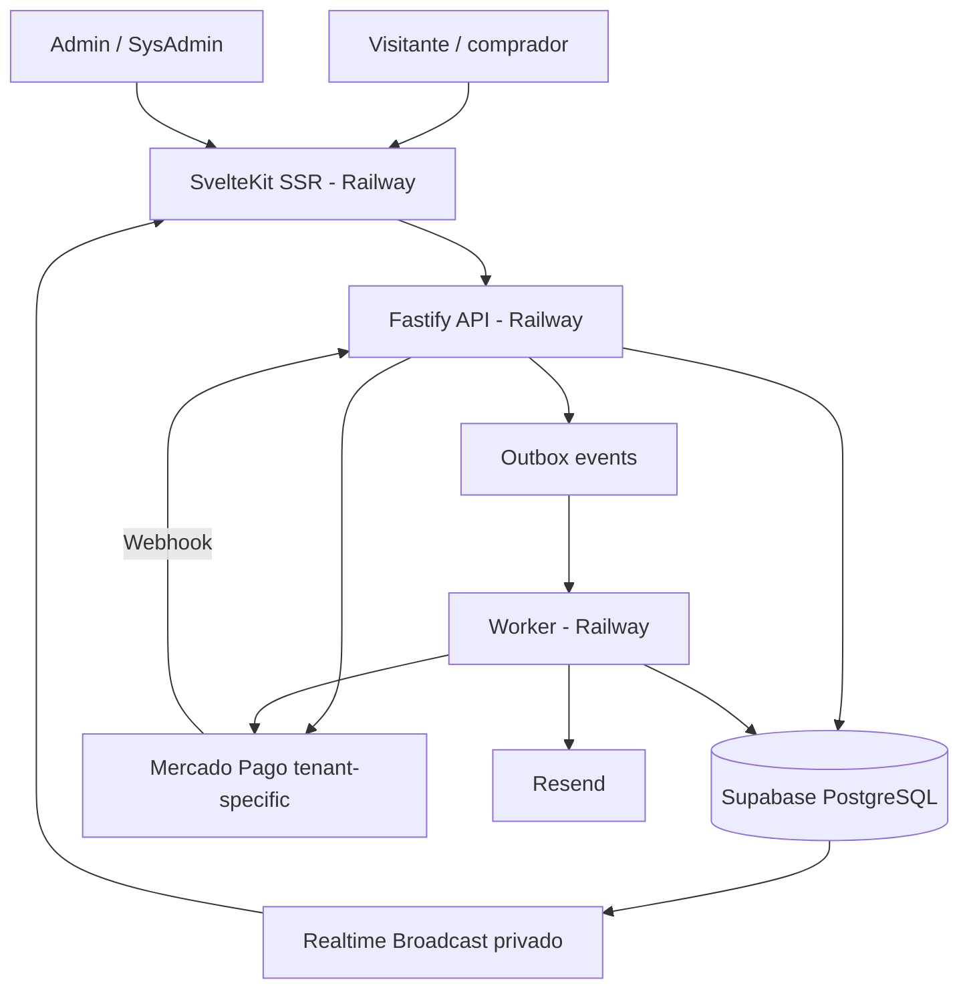

# Arquitectura técnica
## Principios
Monolito modular API + worker, sin microservicios; dominio desacoplado de marca y PSP; integridad antes que velocidad aparente; eventos por outbox.

### API modules
`iam`, `organizations`, `integrations`, `themes`, `cms`, `catalog`, `checkout`, `payments`, `reconciliation`, `campaigns`, `prizes`, `participations`, `draw-integrity`, `notifications`, `audit`, `reporting`.
### Boundaries
SvelteKit solo BFF/SSR/UI; Fastify fuente única de reglas de negocio. API privada a través de URL interna cuando sea posible; webhooks expuestos con autenticación del proveedor. Admin Auth Supabase con MFA y validación server-side; comprador guest.
### Transaction patterns
- Webhook no confía en payload como fuente de verdad; verifica autenticidad y consulta al PSP.
- DB transaction para estado de pago + entradas + outbox; índices únicos, locks o aislamiento apropiado.
- Worker procesa outbox con reintentos y deduplicación.
- Realtime envía eventos autorizados, nunca secretos ni PII; UI recarga snapshots.
### Deployment
Railway project: `web`, `api`, `worker`, ambientes preview/staging/production según costo. Supabase project administrado independiente; backups, PITR según plan y RPO/RTO documentados. CI: lint, typecheck, unit, integration, e2e, migration check, security scan, deploy.
